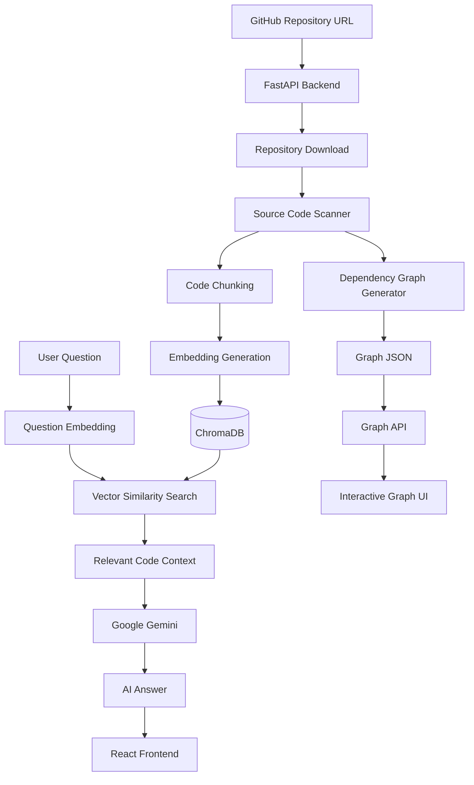

# CodebaseQA 🚀
### AI-Powered Codebase Understanding & Dependency Analysis

<p align="center">
  <strong>Understand any GitHub codebase through AI-powered Q&A, source references, and interactive dependency graphs.</strong>
</p>

<p align="center">
  
  
  
  
  
</p>

---

## Overview

**CodebaseQA** is an AI-powered platform that helps developers understand unfamiliar codebases without manually navigating through every file.

Submit a GitHub repository URL, scan its source code, ask questions in natural language, and explore file-level dependencies through an interactive graph.

The platform combines **Retrieval-Augmented Generation (RAG)** with static dependency analysis to provide code-aware answers and visualize relationships between files.

## Features

- **AI-Powered Codebase Q&A:** Ask natural-language questions about a repository and receive answers based on relevant source code.
- **GitHub Integration:** Download repositories and scan supported source-code files.
- **RAG Pipeline:** Split code into chunks, generate embeddings, and retrieve relevant context using ChromaDB.
- **Gemini Integration:** Generate context-aware answers using Google Gemini.
- **Source References:** Help trace answers back to relevant code and files where supported by the implementation.
- **Interactive Dependency Graph:** Visualize file imports, explore dependencies, and inspect incoming and outgoing relationships.
- **Graph Diagnostics:** Inspect available analysis metadata and unresolved imports.
- **Graph Management APIs:** Retrieve graph data, inspect nodes, check generation status, and regenerate graphs.

## Tech Stack

| Technology | Purpose |
|---|---|
| Python | Backend programming |
| FastAPI | REST API |
| React | Frontend interface |
| Vite | Frontend build tooling |
| Tailwind CSS | UI styling |
| ChromaDB | Vector storage and similarity search |
| Google Gemini API | Embeddings and AI-generated answers |
| GitPython | GitHub repository operations |
| JSON | Dependency graph persistence |

## System Architecture



### How It Works

1. Download the specified GitHub repository.
2. Scan supported source-code files.
3. Split source code into manageable chunks.
4. Generate embeddings and index chunks in ChromaDB.
5. Retrieve relevant code chunks when a user asks a question.
6. Use Google Gemini to generate an answer from the retrieved context.
7. Analyze file imports and generate dependency graph data.
8. Display graph relationships through the frontend.

## Project Structure

```text
CodebaseQA/
├── server/
│   ├── main.py
│   ├── config.py
│   ├── chunker.py
│   ├── dependency_graph.py
│   ├── requirements.txt
│   ├── repos/             # Downloaded repositories
│   ├── chroma_db/         # Vector database
│   ├── graph_data/        # Dependency graph JSON
│   └── .env               # Local environment variables
│
├── client/
│   ├── public/
│   ├── src/
│   │   ├── components/
│   │   ├── pages/
│   │   ├── services/
│   │   ├── App.jsx
│   │   └── main.jsx
│   ├── package.json
│   └── .env
│
├── .gitignore
└── README.md
```

## Getting Started

### Prerequisites

- Python 3.10+
- Node.js and npm
- Git
- Google Gemini API key

### 1. Clone the Repository

```bash
git clone https://github.com/Vaibhav8629/CodeBaseQA.git
cd CodeBaseQA
```

### 2. Set Up the Backend

```bash
cd server
python -m venv venv
```

Activate the virtual environment on Windows:

```powershell
.\venv\Scripts\Activate.ps1
```

Install dependencies:

```bash
pip install -r requirements.txt
```

Create `server/.env`:

```env
GOOGLE_API_KEY=your_gemini_api_key
FRONTEND_URL=http://localhost:5173
```

Start the backend:

```bash
uvicorn main:app --reload
```

Backend: `http://127.0.0.1:8000`

API documentation: `http://127.0.0.1:8000/docs`

### 3. Set Up the Frontend

Open a separate terminal:

```bash
cd client
npm install
```

Create `client/.env`:

```env
VITE_API_BASE_URL=http://localhost:8000
```

Start the frontend:

```bash
npm run dev
```

Open the local URL printed by Vite.

## API Reference

Base URL: `http://127.0.0.1:8000`

Interactive documentation: `http://127.0.0.1:8000/docs`

| Method | Endpoint | Description |
|---|---|---|
| GET | `/` | Root endpoint |
| GET | `/api/health` | Health check |
| POST | `/api/repo/download` | Download a GitHub repository |
| POST | `/api/repo/scan` | Scan and process repository files |
| POST | `/api/repo/ask` | Ask questions about a repository |
| GET | `/api/repo/{repo_id}/graph` | Retrieve dependency graph data |
| GET | `/api/repo/{repo_id}/graph/nodes/{node_id}` | Retrieve a graph node |
| GET | `/api/repo/{repo_id}/graph/nodes/{node_id}/dependencies` | Retrieve node dependencies |
| GET | `/api/repo/{repo_id}/graph/neighborhood/{node_id}` | Retrieve a node's neighborhood |
| GET | `/api/repo/{repo_id}/graph/diagnostics` | Retrieve graph diagnostics |
| POST | `/api/repo/{repo_id}/graph/regenerate` | Regenerate the dependency graph |
| GET | `/api/repo/{repo_id}/graph/status` | Check graph-generation status |

## Deployment

- **Frontend:** Vercel
- **Backend:** Render
- Configure `GOOGLE_API_KEY` and `FRONTEND_URL` in Render environment variables.
- Configure `VITE_API_BASE_URL` in Vercel to point to the deployed backend.
- Keep API keys and local `.env` files out of version control.
- Render's ephemeral filesystem may not preserve downloaded repositories, ChromaDB data, or graph files across restarts or redeployments.